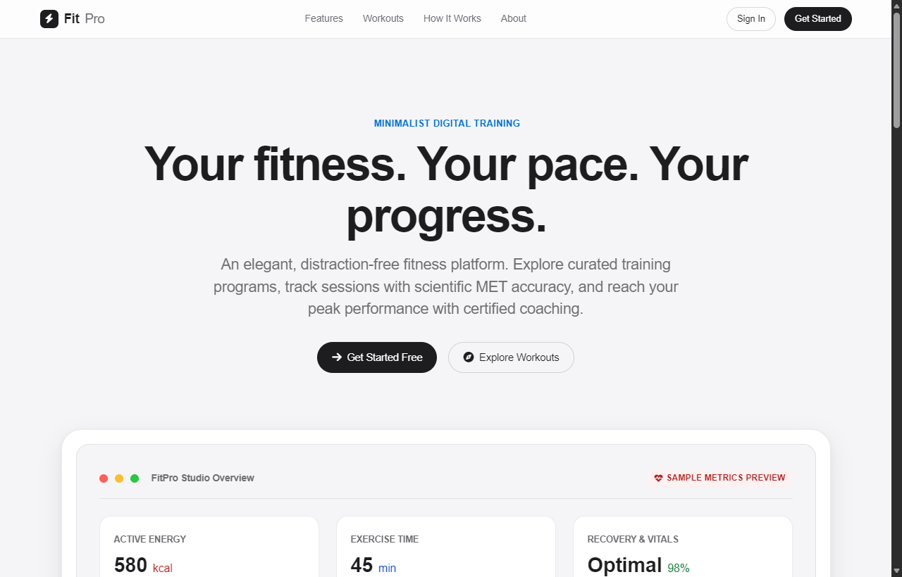
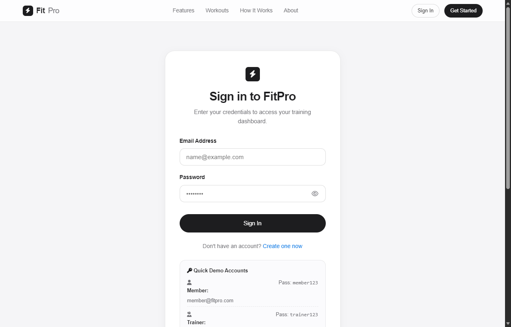
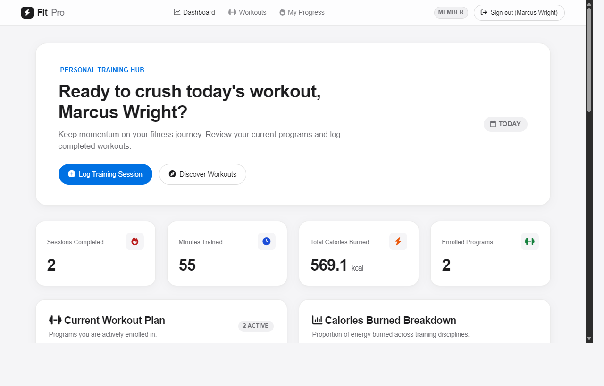
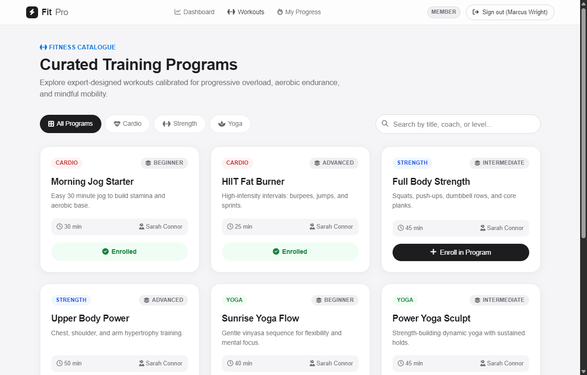
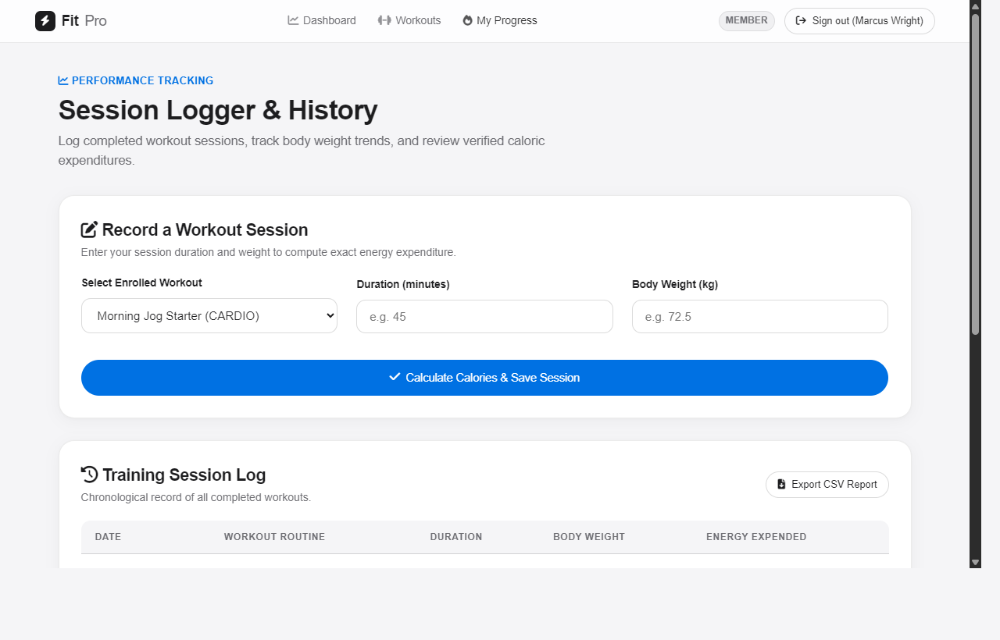
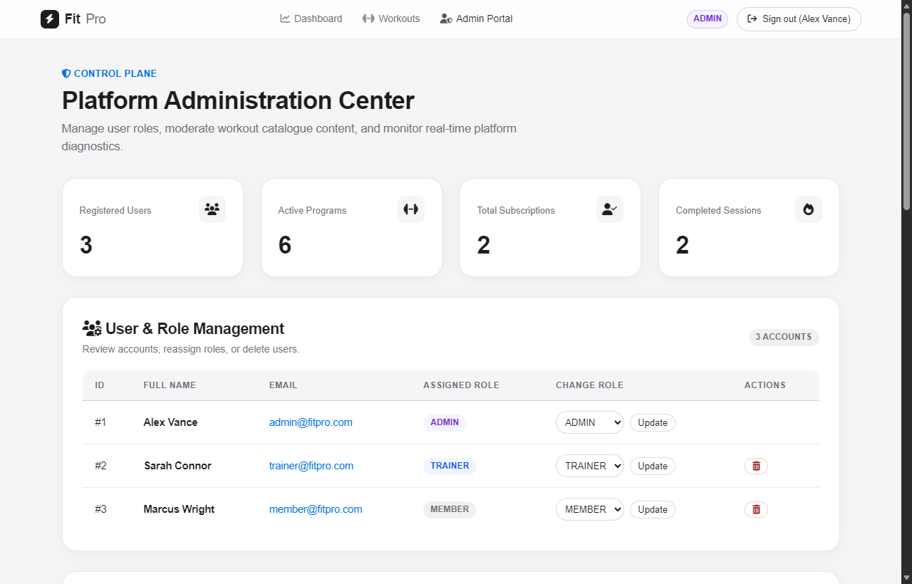

# FitPro — Online Fitness Training Platform

**Live Demo:** [Open FitPro Showcase](https://fitpro-theta.vercel.app/) *(Public Presentation Showcase)*  
**Source Code:** [GitHub Repository](https://github.com/adiithakurr110/FitPro-Fitness-Platform)  
**Local Setup:** See the installation instructions below to run the complete Java backend.

---

## 1. Introduction

FitPro is a fitness technology platform developed in Core Java using Servlets, JSP, JDBC, and Java Swing. It provides structured workout routine management, session progress tracking, and role-based access control for gym members, trainers, and platform administrators. Built with a minimal, Apple-inspired interface, the application demonstrates solid software engineering principles without relying on bloated third-party frameworks.

---

## 2. Features

### Member
- Secure registration and login with salted PBKDF2 password hashing.
- Browse and filter workout routines by discipline (Cardio, Strength, Yoga) and difficulty tier.
- Search routines by title and description keywords.
- One-click enrollment with duplicate enrollment prevention.
- Log training sessions with duration (minutes) and body weight (kg).
- Dynamic calorie calculation using polymorphic MET formulas based on exercise discipline.
- Personal dashboard displaying completed sessions, total active minutes, and calorie burn trends.
- One-click CSV export of historical training logs (`fitpro_progress_report.csv`).

### Trainer
- Dedicated trainer dashboard to create and publish structured workout programs.
- Set target duration, category, difficulty, and MET intensity value.
- View and manage published routines.
- Monitor active member enrollments across programs.

### Administrator
- Dedicated `/app/admin` portal protected by server-side role authorization checks.
- User management: view registered users, update roles (Member, Trainer, Admin), and delete accounts.
- Safeguards preventing administrators from demoting or deleting their own superuser account.
- Platform moderation: remove inappropriate or outdated workout programs.
- System diagnostics view displaying JVM memory usage, allocated heap, and active CPU cores.

### Desktop Admin GUI (Java Swing)
- Standalone desktop client connecting directly to the database via JDBC DAOs (`com.fitpro.gui.FitProAdminGUI`).
- Employs `SwingWorker` for background database queries, preventing Event Dispatch Thread (EDT) freezes.
- Searchable and sortable member directory displayed in a clean `JTable`.

---

## 3. Screenshots

| Screen | Preview |
|---|---|
| **Landing Page** |  |
| **Authentication** |  |
| **Member Dashboard** |  |
| **Workout Catalogue** |  |
| **Progress & CSV Export** |  |
| **Admin Portal** |  |

---

## 4. Technology Stack

- **Language:** Java 11 (compatible with JDK 11, 17, 21, and 26)
- **Web Tier:** Java Servlets 4.0 (`javax.servlet`), JSTL 1.2
- **View Tier:** JavaServer Pages (JSP 2.3), HTML5, CSS3, vanilla JavaScript
- **Desktop Client:** Java Swing (`JFrame`, `JTable`, `CardLayout`, `SwingWorker`)
- **Persistence Tier:** JDBC with `PreparedStatement`, dual-mode Embedded H2 Database (default) and MySQL 8
- **Build Tool:** Apache Maven 3.6+
- **Testing:** JUnit 5 (Jupiter 5.10.1) — 39 automated tests
- **Server:** Apache Tomcat 9 (automated via Maven Cargo plugin)

---

## 5. How the Application Works

FitPro is structured as a classic layered Model-View-Controller (MVC) architecture:

1. **Presentation (View):** Users interact with JSP pages styled with a minimal Apple-inspired design system. Output is escaped using JSTL `<c:out>` to prevent cross-site scripting (XSS).
2. **Controller (Servlets):** 7 Java Servlets handle incoming HTTP requests:
   - `LoginServlet` (`/login`), `RegisterServlet` (`/register`), `LogoutServlet` (`/logout`)
   - `DashboardServlet` (`/app/dashboard`)
   - `WorkoutServlet` (`/app/workouts`)
   - `ProgressServlet` (`/app/progress`)
   - `AdminServlet` (`/app/admin`)
3. **Security Filter:** `AuthFilter` intercepts all `/app/*` routes, checking the HTTP session. Unauthenticated requests are redirected to `/login`. Servlets enforce role-based access for `TRAINER` and `ADMIN` actions.
4. **Service Layer:** Business logic, input validation, and calorie math are isolated in `AuthService`, `WorkoutService`, `ProgressService`, and `NotificationService`. State-changing POST requests use the Post/Redirect/Get (PRG) pattern to eliminate duplicate submissions on refresh.
5. **Data Access (DAOs):** `UserDAO`, `WorkoutDAO`, `EnrollmentDAO`, and `ProgressDAO` implement the generic `BaseDAO<T, ID>` interface, executing queries through parameterized `PreparedStatement` within `try-with-resources` blocks.
6. **Database Management:** `DBConnection` provides thread-safe connection pooling. It defaults to an embedded persistent H2 database (`./data/fitpro_db.mv.db`), automatically initializing schema tables and demo accounts on first run. If MySQL is configured, it connects to MySQL with automatic fallback to H2 if the server is unreachable.
7. **Concurrency:** `NotificationService` dispatches asynchronous welcome notifications using an `ExecutorService` thread pool. `AppContextListener` shuts down the thread pool cleanly on container undeployment.

---

## 6. Prerequisites

- **Java Development Kit (JDK):** Version 11 or higher (`java -version`)
- **Apache Maven:** Version 3.6 or higher (`mvn -version`)
- **Web Browser:** Any modern web browser

---

## 7. Local Installation

1. Clone the repository:
   ```bash
   git clone https://github.com/adiithakurr110/FitPro-Fitness-Platform.git
   cd FitPro-Fitness-Platform
   ```
   *(If your cloned directory contains an inner `fitpro/` folder, navigate into it: `cd fitpro`)*

2. Build the project and package the WAR:
   ```bash
   mvn clean package
   ```

---

## 8. Configuration

FitPro works immediately out of the box with zero external database installation using embedded H2.

Database settings are configured in `src/main/resources/db.properties` or overridden via environment variables:

- **Embedded H2 Database (Default):**
  - `db.type=h2` (or environment variable `DB_TYPE=h2`)
  - Data is stored persistently in `./data/fitpro_db.mv.db`.
- **MySQL 8 Database (Optional):**
  - Set `db.type=mysql` (or environment variable `DB_TYPE=mysql`)
  - Configure credentials:
    ```bash
    export DB_URL="jdbc:mysql://localhost:3306/fitpro?useSSL=false&serverTimezone=UTC"
    export DB_USER="root"
    export DB_PASSWORD="your_password"
    ```
  - If MySQL is unreachable, the application logs a warning and falls back to embedded H2.

---

## 9. Running the Application

### Option A: Run the Web Application on Tomcat 9 (Recommended)
Launch the pre-configured embedded Tomcat 9 server using the Maven Cargo plugin:
```bash
mvn package cargo:run
```
Once the console displays `Tomcat 9.0.82 started on port [8080]`, open your browser at:
- **Public Landing Page:** `http://localhost:8080/fitpro/`
- **Login Portal:** `http://localhost:8080/fitpro/login`
- **Registration Page:** `http://localhost:8080/fitpro/register`
- **Member Dashboard:** `http://localhost:8080/fitpro/app/dashboard` (protected)

*(Windows shortcut: double-click `run-app.bat`)*

### Option B: Run the Desktop Administration Swing GUI
Launch the standalone Java Swing administration window:
```bash
mvn compile exec:java
```
*(Windows shortcut: double-click `run-gui.bat`)*

### Pre-Seeded Demonstration Accounts:

| Role | Email / Username | Password | Primary Capabilities |
|---|---|---|---|
| **Member** | `member@fitpro.com` *(or Marcus Wright)* | `member123` | Browse workouts, enroll, log sessions, view calorie analytics, export CSV |
| **Trainer** | `trainer@fitpro.com` *(or Sarah Connor)* | `trainer123` | Publish workout routines, delete own routines, view assigned members |
| **Admin** | `admin@fitpro.com` *(or Alex Vance)* | `admin123` | Manage user roles, delete accounts, moderate workouts, view JVM metrics |

*(You can log in using either registered email or full name, or register a new member account at `/fitpro/register`)*

---

## 10. Testing

Execute the automated test suite using Maven:
```bash
mvn clean test
```

### Verified Test Results:
- **Total Tests:** 40
- **Passing:** 40
- **Failures:** 0
- **Errors:** 0
- **Skipped:** 0
- **Build Status:** `BUILD SUCCESS` (JUnit 5 Jupiter)
- **Coverage Summary:**
  - `DAOTest`: CRUD operations across users, workouts, enrollments, and progress logs
  - `UserModelTest`: Role predicate verification (`isMember`, `isTrainer`, `isAdmin`)
  - `WorkoutModelTest`: Dynamic polymorphic calorie formulas across Cardio, Strength, and Yoga
  - `AuthServiceTest`: Registration validation, role tampering prevention, salted hash verification
  - `WorkoutServiceTest`: Enrollment business rules, duplicate enrollment blocks, trainer publication
  - `ProgressServiceTest`: Session logging, duration and body weight validation, history retrieval
  - `DBConnectionTest`: Dual-mode H2 connection, schema verification, multithreaded notification counter
  - `PasswordUtilTest`: PBKDF2 hashing, random salt generation, constant-time verification

---

## 11. Project Structure

```
fitpro/
├── pom.xml                               # Maven build configuration and dependencies
├── README.md                             # Project documentation
├── index.html                            # Minimal static frontend showcase for Vercel
├── vercel.json                           # Vercel deployment configuration
├── run-app.bat                           # 1-click Windows runner for Tomcat 9 web app
├── run-gui.bat                           # 1-click Windows runner for Desktop Swing GUI
├── docs/
│   ├── DEVELOPMENT.md                    # Developer and architecture guide
│   ├── FitPro_Final_Presentation.pptx    # Viva evaluation PowerPoint presentation
│   ├── FitPro_Presentation_v3.pdf        # Presentation slides (PDF)
│   ├── FitPro_Presentation_v3.pptx       # Original presentation master (PowerPoint)
│   └── screenshots/                      # Application UI screenshot captures
└── src/
    ├── main/
    │   ├── java/com/fitpro/
    │   │   ├── dao/                      # JDBC DAOs (BaseDAO, UserDAO, WorkoutDAO, etc.)
    │   │   ├── exception/                # Application exceptions (AppException)
    │   │   ├── filter/                   # Session authentication filter (AuthFilter)
    │   │   ├── gui/                      # Desktop Swing Admin GUI (FitProAdminGUI)
    │   │   ├── listener/                 # Context listener for thread pool cleanup
    │   │   ├── model/                    # Domain entities (User, Member, Trainer, Admin, Workout)
    │   │   ├── service/                  # Business logic (AuthService, WorkoutService, etc.)
    │   │   ├── servlet/                  # HTTP controllers (Login, Register, Dashboard, etc.)
    │   │   └── util/                     # Database connection pool and password hashing
    │   ├── resources/
    │   │   ├── db.properties             # Database configuration
    │   │   └── schema.sql                # Relational database schema definitions
    │   └── webapp/
    │       ├── index.jsp                 # Web landing page
    │       ├── css/style.css             # Apple-inspired design system stylesheet
    │       ├── js/app.js                 # Client-side validation and search interactions
    │       └── WEB-INF/
    │           ├── web.xml               # Deployment descriptor
    │           └── views/                # Modular JSP views (dashboard, workouts, progress, admin)
    └── test/java/com/fitpro/             # 39 JUnit 5 unit and integration tests
```

---

## 12. Limitations

1. **Email Gateway:** `NotificationService` simulates asynchronous email delivery via background worker threads and console logging rather than connecting to an active external SMTP mail server.
2. **Calorie Formulas:** MET formulas use standard exercise energy expenditure averages rather than clinical wearable biometric sensor telemetry.
3. **Cloud Backend Hosting:** The public demo on Vercel serves the static presentation showcase; full dynamic Servlet execution requires a Java Servlet container (Apache Tomcat 9) as documented in the installation guide.

---

## 13. College Marking Rubrics Alignment

### Java GUI Based Projects Marking Rubric (17 Marks Total)
1. **Servlet Implementation (10 Marks):** 7 Servlets handling complete HTTP request/response cycle, `HttpSession` state tracking, URL routing, filter chaining (`AuthFilter`), and centralized error handling (`error.jsp`).
2. **Code Quality & Execution (5 Marks):** Clean MVC layered separation (Model, DAO, Service, Servlet, View), Java 11 coding standards, try-with-resources, Swing desktop GUI client (`FitProAdminGUI`) with `SwingWorker`.
3. **Innovation / Extra Effort (2 Marks):** Dual-interface architecture (Web App + Swing GUI), zero-configuration dual-mode database (embedded H2 + MySQL 8), PBKDF2 cryptography, async notification thread pool.

### Java Web Based Projects Marking Rubric (17 Marks Total)
1. **Code Quality & Testing (10 Marks):** 39 automated JUnit tests covering DAOs, Services, Password Hashing, MVC flow; strict input validation, zero compiler warnings.
2. **Teamwork & Collaboration (5 Marks):** Clear separation of ownership: Aditya Singh (Architecture, Auth, Admin), Manik (Service Layer, DAOs, Multithreading & Testing), Harshit Vats (Frontend JSPs, Apple CSS, Swing GUI); clean Git branch history.
3. **Innovation / Extra Effort (2 Marks):** Apple-inspired minimalist design system, live CSV progress report export, zero-dependency embedded Tomcat execution (`mvn cargo:run`), resilient fallback connection handling.

---

## 14. Author and Repository

- **Repository:** [https://github.com/adiithakurr110/FitPro-Fitness-Platform](https://github.com/adiithakurr110/FitPro-Fitness-Platform)
- **Team Members:**
  - Aditya Singh (25scse1180171)
  - Manik (25scse1180216)
  - Harshit Vats (25scse1180097)
