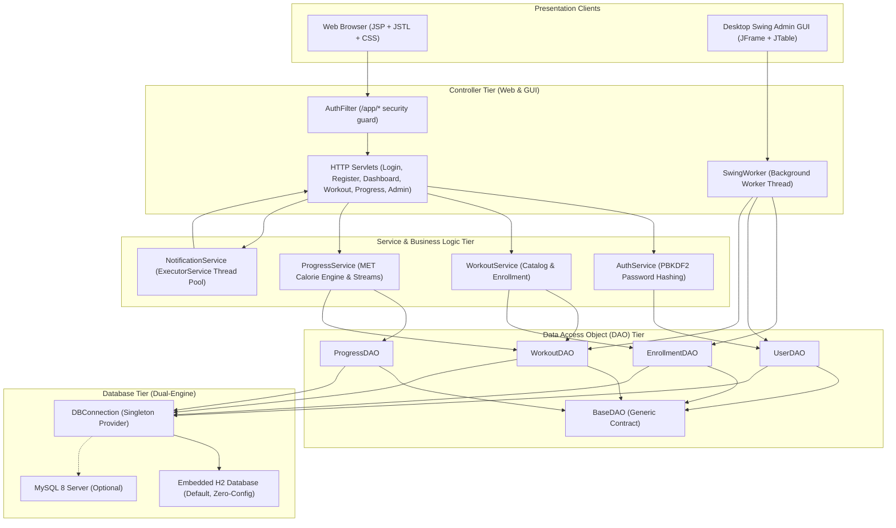

# FitPro - Online Fitness Training Platform

[](https://www.oracle.com/java/)
[](https://tomcat.apache.org/)
[](https://tomcat.apache.org/)
[](https://docs.oracle.com/javase/tutorial/uiswing/)
[](https://docs.oracle.com/javase/tutorial/jdbc/)
[](https://www.h2database.com/)
[](https://maven.apache.org/)
[](https://junit.org/junit5/)

A full-stack **Java Enterprise Web & Desktop Application** designed for digital fitness coaching. FitPro allows fitness trainers to design and publish structured workout routines while providing members with an intuitive dashboard to enroll in programs, track individual training sessions, and view precise calorie burn metrics based on scientific metabolic equivalent of task (MET) formulas.

The platform is engineered using a robust layered **Model-View-Controller (MVC)** architecture and supports both **Web Access** (Servlets/JSP) and **Desktop Access** (Java Swing GUI).

---

## 🌟 Key Capabilities & User Experience

| For Members | For Trainers & Administrators |
|---|---|
| 🔐 **Secure Account Management** (Salted PBKDF2 Password Hashing) | 🛡️ **Role-Based Access Control** (Differentiated Member / Trainer roles) |
| 🏋️ **Workout Catalog & Filtering** (Cardio, Strength, and Yoga) | 📝 **Publish Workout Routines** with custom intensity levels & MET values |
| ⚡ **One-Click Enrollment** in fitness programs | 👥 **Enrolled Members Directory** with subscriber details & dates |
| 📊 **Interactive Dashboard** featuring currently enrolled workouts | 🖥️ **Admin Web Portal** (`/app/admin`) for platform metrics |
| ⏱️ **Workout Session Logging** (Duration trained + body weight in kg) | 💻 **Desktop Admin GUI** (`FitProAdminGUI.java`) built with Java Swing |
| 🔥 **Dynamic Calorie Computation** based on workout type & EPOC factor | 🧵 **Asynchronous Notifications** processed via background worker threads |
| 📈 **Visual Progress Analytics** with calories-by-category breakdown | 🗄️ **Zero-Config Dual-Engine Database** (Embedded H2 & MySQL 8) |

---

## 💻 Tech Stack & Architecture

| Layer | Language / Technology | Implementation Details |
|---|---|---|
| **Backend Core** | Java 11+ (JDK 21/26 compatible) | Layered MVC, OOP principles, Multithreading (`ExecutorService`, `SwingWorker`), Collections, Streams |
| **Web Presentation** | JSP 2.3 + JSTL 1.2 + EL | Dynamic server-side rendering, XSS prevention via `<c:out>`, custom fragments (`header.jspf`, `footer.jspf`) |
| **Desktop GUI** | Java Swing / AWT | Desktop Admin GUI (`FitProAdminGUI`) with `JFrame`, `JTable`, `DefaultTableModel`, `SwingWorker` |
| **Frontend Styling** | HTML5, CSS3, Vanilla JavaScript | Responsive dark-mode design system, CSS Grid, Flexbox, FontAwesome 6 icons |
| **Database & JDBC** | SQL (MySQL 8 & Embedded H2) | Normalized relational schema, Foreign Keys, Cascades, parameterized `PreparedStatement` JDBC execution |
| **Build & Deployment**| Maven 3.9+ & Apache Tomcat 9 | Automated packaging (`fitpro.war`) and embedded Cargo container runner |
| **Quality Assurance**| JUnit 5 | Automated integration tests for JDBC, DAOs, Multithreading, and OOP Polymorphism |

---

## 🏛️ System Architecture



---

## 🧩 Core Java Concepts Implemented

### 1. Object-Oriented Programming (OOP)
- **Inheritance**:
  - `User` is the abstract base class inherited by `Member` and `Trainer`.
  - `Workout` is the abstract base class inherited by `CardioWorkout`, `StrengthWorkout`, and `YogaWorkout`.
  - `FitProAdminGUI` inherits from `javax.swing.JFrame`.
- **Polymorphism**:
  - `CalorieCalculable` interface defines `caloriesBurned(double weightKg, int durationMin)`.
  - `CardioWorkout` applies the standard MET formula.
  - `StrengthWorkout` overrides the formula with a 10% EPOC ("afterburn") multiplier.
  - `YogaWorkout` overrides the formula with a 0.90 low-intensity adjustment.
  - Polymorphic greeting: `User.getWelcomeMessage()` returns role-tailored greetings for members vs trainers.
  - Factory methods: `Workout.of(type)` and `User.of(role)` construct specific subclasses at runtime.
- **Abstraction**:
  - Abstract classes `Workout` and `User` enforce contracts for concrete implementations.
  - Generic interface `BaseDAO<T, ID>` establishes the data access abstraction.
- **Encapsulation**:
  - All domain model properties are private with public getters and setters.

### 2. Collections & Generics
- **Generics**: Generic interface `BaseDAO<T, ID>` provides reusable CRUD signatures (`findById(ID id)`, `findAll()`).
- **Lists**: `List<EnrollmentDetail>`, `List<Workout>`, `List<User>`, and `List<ProgressLog>`.
- **Sets**: `Set<Integer>` in `EnrollmentDAO.findEnrolledIds()` delivers $O(1)$ lookup speed for checking program enrollment status.
- **Maps**: `TreeMap<String, Double>` in `ProgressService` maintains a sorted category-wise calorie burn breakdown.
- **Streams & Lambdas**: Used extensively in `ProgressService` for filtering, grouping, and aggregating calorie totals.

### 3. Multithreading & Synchronization
- **Web Background Processing**: `NotificationService` initializes a dedicated thread pool via `ExecutorService` (`Executors.newFixedThreadPool(2)`). Asynchronous notifications (welcome messages, enrollment alerts) are dispatched without blocking HTTP requests.
- **Thread Synchronization**: Shared notification metrics are protected with `synchronized int increment()` and `synchronized int getSentCount()` to prevent race conditions.
- **Desktop UI Multithreading**: `FitProAdminGUI` implements `SwingWorker<List<EnrollmentDetail>, Void>` to fetch database records on a background worker thread, keeping the Swing Event Dispatch Thread (EDT) completely responsive.

### 4. Exception Handling
- **Domain Exceptions**: Custom checked exception `AppException` wraps underlying database and application failures.
- **Resource Management**: Comprehensive use of **try-with-resources** (`AutoCloseable`) on all JDBC `Connection`, `PreparedStatement`, and `ResultSet` instances guarantees no memory or socket leaks.

### 5. Database Integration & JDBC Design
- **Dual-Engine Architecture**: `DBConnection.java` connects out-of-the-box to an embedded H2 database (`./data/fitpro_db.mv.db`) with zero configuration, and effortlessly supports MySQL 8.
- **SQL Injection Defense**: 100% of SQL queries utilize parameterized `PreparedStatement`.
- **Relational Integrity**: 4 normalized tables (`USERS`, `WORKOUTS`, `ENROLLMENTS`, `PROGRESS_LOGS`) with Primary Keys, Foreign Keys, and `ON DELETE CASCADE`.
- **Automated Schema Initialization**: `schema.sql` automatically runs on application startup to verify and create tables.

### 6. Servlets & Web MVC Integration
- **Controllers**: 7 dedicated Servlets (`LoginServlet`, `RegisterServlet`, `LogoutServlet`, `DashboardServlet`, `WorkoutServlet`, `ProgressServlet`, `AdminServlet`).
- **Security Interceptor**: `AuthFilter` intercepts `/app/*` requests, validating active user sessions and redirecting unauthenticated traffic to `/login`.
- **Application Lifecycle**: `AppContextListener` (`ServletContextListener`) initializes database tables upon application startup and gracefully terminates thread pools upon server shutdown.
- **State Management**: Session attributes (`session.setAttribute("user", ...)`) maintain login state with session regeneration and `HttpOnly` cookie flags.

---

## 📂 Project Directory Structure

```
fitpro/
├── pom.xml                                     Maven project descriptor & dependencies
├── README.md                                   Comprehensive project documentation
├── database/
│   └── schema.sql                              Relational SQL schema & initial seed data
├── docs/
│   ├── FitPro_Presentation_v3.pptx             Official presentation slide deck (PowerPoint)
│   └── FitPro_Presentation_v3.pdf              Official presentation document (PDF)
└── src/
    ├── main/
    │   ├── java/com/fitpro/
    │   │   ├── dao/                            Data Access Object Layer
    │   │   │   ├── BaseDAO.java                Generic DAO interface (Generics)
    │   │   │   ├── EnrollmentDAO.java          Member enrollment JDBC operations & admin reporting
    │   │   │   ├── ProgressDAO.java            Workout session logs JDBC operations
    │   │   │   ├── UserDAO.java                Account authentication & profile JDBC operations
    │   │   │   └── WorkoutDAO.java             Workout catalog & publishing JDBC operations
    │   │   ├── exception/
    │   │   │   └── AppException.java           Custom domain checked exception
    │   │   ├── filter/
    │   │   │   └── AuthFilter.java             Security filter guarding /app/* routes
    │   │   ├── gui/
    │   │   │   └── FitProAdminGUI.java         Desktop Swing Administration Console (SwingWorker)
    │   │   ├── listener/
    │   │   │   └── AppContextListener.java     Web listener for startup & thread pool shutdown
    │   │   ├── model/                          Domain Model Layer (OOP)
    │   │   │   ├── CalorieCalculable.java      Polymorphic calorie calculation interface
    │   │   │   ├── CardioWorkout.java          Cardio workout model (Standard MET)
    │   │   │   ├── EnrollmentDetail.java       DTO for admin enrollment reporting
    │   │   │   ├── Member.java                 Member user model (Inheritance)
    │   │   │   ├── ProgressLog.java            Session workout progress model
    │   │   │   ├── StrengthWorkout.java        Strength workout model (10% EPOC bonus)
    │   │   │   ├── Trainer.java                Trainer / Admin user model (Inheritance)
    │   │   │   ├── User.java                   Abstract base user model
    │   │   │   ├── Workout.java                Abstract base workout model
    │   │   │   └── YogaWorkout.java            Yoga workout model (0.90 factor)
    │   │   ├── service/                        Business Logic Service Layer
    │   │   │   ├── AuthService.java            Authentication & PBKDF2 hashing service
    │   │   │   ├── NotificationService.java    Multithreaded notification worker pool
    │   │   │   ├── ProgressService.java        Calorie analytics & Java Stream service
    │   │   │   └── WorkoutService.java         Program catalog & enrollment service
    │   │   ├── servlet/                        Web Controller Layer (Servlets 4.0)
    │   │   │   ├── AdminServlet.java           Admin portal controller (/app/admin)
    │   │   │   ├── DashboardServlet.java       Member dashboard controller (/app/dashboard)
    │   │   │   ├── LoginServlet.java           User login controller (/login)
    │   │   │   ├── LogoutServlet.java          Session invalidation controller (/logout)
    │   │   │   ├── ProgressServlet.java        Session logging controller (/app/progress)
    │   │   │   ├── RegisterServlet.java        User registration controller (/register)
    │   │   │   └── WorkoutServlet.java         Program catalog & enrollment controller (/app/workouts)
    │   │   └── util/
    │   │       ├── DBConnection.java           JDBC connection manager (H2 / MySQL)
    │   │       └── PasswordUtil.java           PBKDF2-HMAC-SHA256 password hashing utility
    │   ├── resources/
    │   │   ├── db.properties                   Database connection configuration
    │   │   └── schema.sql                      Packaged classpath database schema
    │   └── webapp/
    │       ├── index.jsp                       Landing page / redirect
    │       ├── css/style.css                   Modern responsive design system
    │       ├── js/app.js                       Client-side UI interaction scripts
    │       └── WEB-INF/
    │           ├── web.xml                     Servlet deployment descriptor
    │           └── views/                      Server-rendered dynamic JSP views
    │               ├── admin.jsp               Admin Portal & Enrolled Members Directory
    │               ├── dashboard.jsp           Member Dashboard with Enrolled Workouts
    │               ├── error.jsp               Application error display page
    │               ├── footer.jspf             Reusable HTML footer fragment
    │               ├── header.jspf             Reusable navigation header fragment
    │               ├── login.jsp               User authentication login page
    │               ├── progress.jsp            Workout session logger & history
    │               ├── register.jsp            User account registration page
    │               └── workouts.jsp            Workout catalog with program enrollment
    └── test/java/com/fitpro/util/
        └── DBConnectionTest.java               JUnit 5 test suite verifying JDBC, DAOs, Threading & OOP
```

---

## 🚀 Setup & Execution Guide

### Prerequisites
- **Java Development Kit (JDK 11 or higher)**
  ```bash
  java -version
  ```
- **Apache Maven 3.6+**
  ```bash
  mvn -version
  ```

---

### 1. Launch the Web Application (One Command)
FitPro bundles the Maven Cargo Tomcat plugin. Simply execute:

```bash
mvn package cargo:run
```

Once Tomcat boots, open your web browser and visit:
```
http://localhost:8080/fitpro/
```

#### Application Endpoints:
- **Registration**: `http://localhost:8080/fitpro/register`
- **Login**: `http://localhost:8080/fitpro/login`
- **Member Dashboard**: `http://localhost:8080/fitpro/app/dashboard`
- **Workout Catalog**: `http://localhost:8080/fitpro/app/workouts`
- **Session Logger**: `http://localhost:8080/fitpro/app/progress`
- **Admin & Trainer Portal**: `http://localhost:8080/fitpro/app/admin`

---

### 2. Launch the Desktop Admin GUI
You can run the standalone Java Swing administration desktop application at any time:

```bash
java -cp "target/classes;target/fitpro/WEB-INF/lib/*" com.fitpro.gui.FitProAdminGUI
```

*Features of the Desktop GUI:*
- Real-time display of all enrolled members, workout titles, categories, and enrollment dates.
- Asynchronous database queries via `SwingWorker` with animated status indicator.
- One-click button to open the web portal directly in your default browser.

---

### 3. Run the Automated Test Suite
Run the JUnit 5 test suite to verify database connectivity, relational tables, DAOs, polymorphic calculations, and multithreading:

```bash
mvn test
```

*Test Results Overview:*
```
[TEST] Connected to database: H2 v2.2.224 (Driver: H2 JDBC Driver)
[TEST] All 4 schema tables verified successfully (USERS, WORKOUTS, ENROLLMENTS, PROGRESS_LOGS)
[TEST] Polymorphic calories calculated: Cardio=257.25, Strength=202.13, Yoga=99.23
[TEST] Multithreading & Synchronization verified! Sent count: 2
[TEST] User OOP Polymorphism and Abstraction verified!
[INFO] Tests run: 5, Failures: 0, Errors: 0, Skipped: 0
[INFO] BUILD SUCCESS
```

---

### 4. Database Setup (Zero-Config or MySQL)
The platform runs **automatically with zero configuration** using an embedded **H2 Database** (`./data/fitpro_db.mv.db`), self-generating all tables and sample workout routines on startup.

If you prefer connecting to an external **MySQL 8** server:
1. Ensure MySQL is running on port `3306` with database `fitpro`.
2. Edit `src/main/resources/db.properties`:
   ```properties
   db.driver=com.mysql.cj.jdbc.Driver
   db.url=jdbc:mysql://localhost:3306/fitpro?useSSL=false&serverTimezone=UTC&allowPublicKeyRetrieval=true
   db.user=root
   db.password=your_password
   ```
3. Restart the application. FitPro will automatically detect MySQL and initialize the schema.

---

## 🔒 Security Hardening

- **PBKDF2 Password Hashing**: Passwords are salted with 16 bytes of cryptographically secure random salt and hashed using 65,536 iterations of HMAC-SHA256. Plaintext passwords are never stored.
- **SQL Injection Defense**: All database queries are executed strictly through parameterized `PreparedStatement` instances.
- **Cross-Site Scripting (XSS) Mitigation**: All dynamic user-generated content rendered in JSP is sanitized using JSTL `<c:out>`.
- **Session Authentication Guard**: The servlet filter `AuthFilter` inspects every incoming request to `/app/*`. Unauthenticated requests are immediately redirected to the login page.

---

## 📑 Project Presentation & Deliverables

- **PowerPoint Presentation Deck**: [`docs/FitPro_Presentation_v3.pptx`](docs/FitPro_Presentation_v3.pptx)
- **PDF Presentation**: [`docs/FitPro_Presentation_v3.pdf`](docs/FitPro_Presentation_v3.pdf)
- **Database Schema**: [`database/schema.sql`](database/schema.sql)
- **GitHub Repository**: [https://github.com/adiithakurr110/FitPro-Fitness-Platform](https://github.com/adiithakurr110/FitPro-Fitness-Platform)

---

## 🐙 Git Version Control & Deployment Commands

```bash
# 1. Stage modified files
git add .

# 2. Commit changes
git commit -m "Update README with complete architecture, features, and test results"

# 3. Push to GitHub
git push origin main
```
